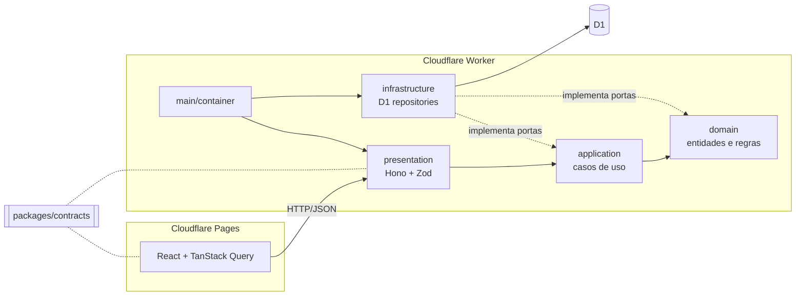

# Fintrack

Controle de finanças pessoais com **CRUD de categorias e transações** e um
**dashboard** de receitas × despesas — rodando 100% na Cloudflare:
**Workers** (API), **D1** (banco SQLite) e **Pages** (front React).

Projeto de portfólio com foco em **Clean Architecture**, **Clean Code** e
**Spec-Driven Development**.

| Camada | Stack                                                                   |
| ------ | ----------------------------------------------------------------------- |
| API    | Cloudflare Workers · Hono · Zod · D1                                    |
| Front  | React 18 · Vite · TanStack Query · React Router · SVG puro nos gráficos |
| Shared | `@fintrack/contracts` — schemas Zod e DTOs usados pelos dois lados      |
| Testes | Vitest (domínio, casos de uso e HTTP)                                   |
| CI/CD  | GitHub Actions + `wrangler-action`                                      |

## Estrutura

```
fintrack/
├── specs/                      ← fonte da verdade (SDD)
│   ├── constitution.md         ← princípios do projeto
│   └── features/
│       ├── 001-categories/     ← spec.md · plan.md · tasks.md
│       ├── 002-transactions/
│       └── 003-dashboard/
├── packages/
│   └── contracts/              ← schemas Zod + DTOs compartilhados
├── apps/
│   ├── api/                    ← Cloudflare Worker
│   │   ├── migrations/         ← D1
│   │   ├── seeds/demo.sql      ← dados de exemplo (só local)
│   │   ├── src/
│   │   │   ├── domain/         ← entidades, value objects, portas de repositório
│   │   │   ├── application/    ← casos de uso + portas (Clock, IdGenerator, ReportReader)
│   │   │   ├── infrastructure/ ← D1, relógio, UUID
│   │   │   ├── presentation/   ← Hono: rotas, validação, mapeamento de erros
│   │   │   └── main/           ← composition root
│   │   └── test/               ← testes nomeados pelos ACs das specs
│   └── web/                    ← Cloudflare Pages (React)
│       └── src/
│           ├── app/            ← layout e rotas
│           ├── features/       ← categories · transactions · dashboard
│           └── shared/         ← cliente HTTP, utilitários, UI base
└── .github/workflows/          ← CI e deploy
```

## Arquitetura



**Regra de dependência:** tudo aponta para o domínio. O domínio não conhece
Hono, Zod nem D1; isso é verificado pelo ESLint (`no-restricted-imports`).

Algumas decisões que valem a pena olhar no código:

- **Invariantes no domínio** — `Transaction.create` recebe a `Category` inteira
  (não só o id) para garantir que o tipo bate (BR-204).
- **Dinheiro em centavos inteiros** — value object `Money`.
- **`CalendarDate`** — rejeita `2026-02-30`, que um regex sozinho aceitaria.
- **CQRS leve no dashboard** — uma porta de leitura (`ReportReader`) faz as
  agregações em SQL em vez de carregar tudo no Worker.
- **Erros tipados** — `ValidationError` → 400, `NotFoundError` → 404,
  `ConflictError` → 409, `BusinessRuleError` → 422, mapeados em um só lugar.
- **Testabilidade** — `createApp(resolveUseCases)` recebe as dependências; os
  testes HTTP sobem o app com repositórios em memória, sem banco.

## Spec-Driven Development

Cada comportamento nasce como um critério de aceite em `specs/` e termina como
um teste com o mesmo id:

```
specs/features/002-transactions/spec.md   →  **AC-204** — Transação income em categoria expense → 422
apps/api/test/application/transactions.test.ts  →  it('AC-204: rejects a transaction whose type differs ...')
```

O CI falha se algum AC (exceto os marcados como `(UI)`) não tiver teste.
Veja `specs/README.md` para o fluxo completo.

## Rodando localmente

Pré-requisitos: Node 20+ e uma conta Cloudflare (gratuita) para o deploy.

```bash
npm install

# Banco local (D1 em SQLite via Miniflare)
npm run db:migrate:local
npm run db:seed:local -w @fintrack/api   # opcional: categorias e transações de exemplo

# Em dois terminais
npm run dev:api    # http://localhost:8787
npm run dev:web    # http://localhost:5173 (o Vite faz proxy de /api)
```

Testes e verificações:

```bash
npm test           # todos os workspaces
npm run check      # typecheck + lint + testes
```

## Deploy na Cloudflare

```bash
npx wrangler login

# 1. Banco
npx wrangler d1 create fintrack-db
#    → copie o database_id para apps/api/wrangler.toml (nos dois blocos)

# 2. API
npm run db:migrate:remote -w @fintrack/api -- --env production
npx wrangler deploy --env production -c apps/api/wrangler.toml
#    → anote a URL: https://fintrack-api.<subdominio>.workers.dev

# 3. Front
VITE_API_URL=https://fintrack-api.<subdominio>.workers.dev npm run deploy -w @fintrack/web
#    → ajuste ALLOWED_ORIGINS em [env.production.vars] com a URL do Pages e
#      faça o deploy da API de novo
```

Pelo GitHub Actions: configure os secrets `CLOUDFLARE_API_TOKEN` e
`CLOUDFLARE_ACCOUNT_ID` e a variável `VITE_API_URL`; todo push na `main`
roda testes, migrations e deploy dos dois apps.

## API

| Método | Rota                                                      | Descrição                                    |
| ------ | --------------------------------------------------------- | -------------------------------------------- |
| GET    | `/api/health`                                             | Health check                                 |
| GET    | `/api/categories`                                         | Lista categorias                             |
| POST   | `/api/categories`                                         | Cria categoria                               |
| PATCH  | `/api/categories/:id`                                     | Renomeia                                     |
| DELETE | `/api/categories/:id`                                     | Exclui (422 se houver transações)            |
| GET    | `/api/transactions?page&pageSize&from&to&type&categoryId` | Lista paginada com filtros                   |
| GET    | `/api/transactions/:id`                                   | Detalhe                                      |
| POST   | `/api/transactions`                                       | Cria                                         |
| PATCH  | `/api/transactions/:id`                                   | Atualização parcial                          |
| DELETE | `/api/transactions/:id`                                   | Exclui                                       |
| GET    | `/api/dashboard/summary?from&to`                          | Totais, série mensal e ranking por categoria |

Erros seguem sempre o formato:

```json
{ "error": { "code": "BUSINESS_RULE_VIOLATION", "message": "..." } }
```

## Próximos passos

Ideias para evoluir o projeto (cada uma começa como uma spec nova):

- **004 — Autenticação** com Cloudflare Access ou JWT, e `userId` em todas as
  tabelas (multiusuário).
- **005 — Orçamento por categoria** com alerta no dashboard.
- **006 — Importação de extrato** (CSV/OFX) usando uma Queue do Workers.
- Testes de integração do D1 com `@cloudflare/vitest-pool-workers`.
- Testes de componente no front com Testing Library.
