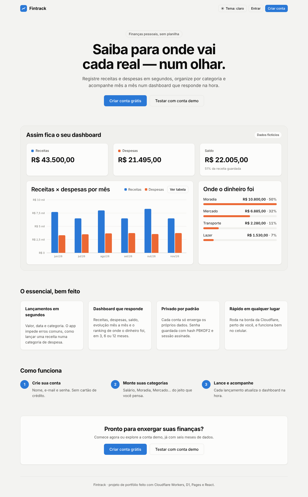
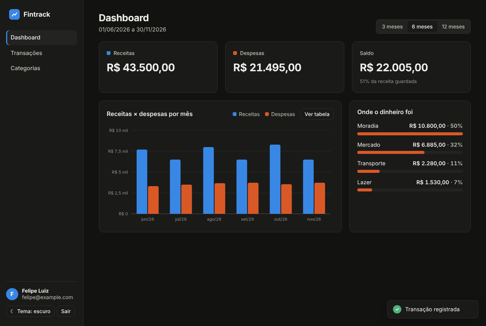
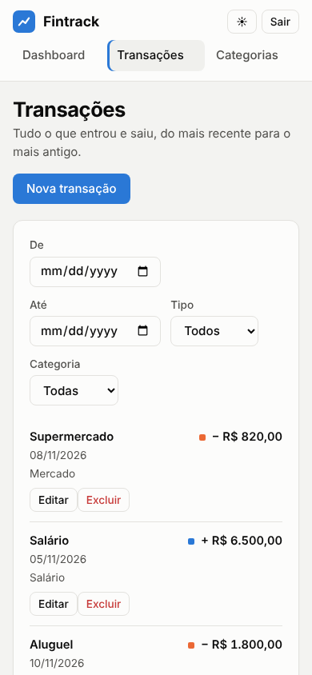
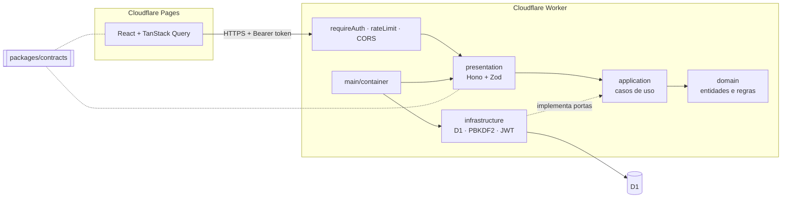

# Fintrack

[](https://github.com/Felipecluiz/Fintrack/actions/workflows/ci.yml)
[](https://github.com/Felipecluiz/Fintrack/actions/workflows/deploy.yml)

**Controle de finanças pessoais** com contas de usuário, CRUD de categorias e
transações e um dashboard de receitas × despesas — 100% na Cloudflare:
**Workers** (API), **D1** (SQLite) e **Pages** (React).

🔗 **Ao vivo:** https://fintrack-web-0ff.pages.dev
🧪 **Conta demo:** `demo@fintrack.dev` / `demo1234` (ou o botão "Testar com conta demo")

Projeto de portfólio com foco em **Clean Architecture**, **Clean Code**,
**Spec-Driven Development** e testes em todos os níveis.



| Dashboard (tema escuro) | Transações no celular |
| --- | --- |
|  |  |

## Destaques

- **Multiusuário seguro** — senha com hash PBKDF2-SHA256 + salt, sessão JWT
  HS256 feita com WebCrypto (sem bibliotecas), rate limit no login, CORS
  restrito e cabeçalhos de segurança (CSP) no front.
- **Isolamento por construção** — os repositórios D1 nascem presos a um dono;
  nenhum caso de uso consegue ler dados de outro usuário, nem por engano.
- **Domínio rico** — `Money` em centavos, `CalendarDate` que rejeita
  `2026-02-30`, `Email`, regras como "receita só em categoria de receita".
- **Dashboard sem biblioteca de gráficos** — SVG próprio com legenda, tooltip,
  escala única, alternativa em tabela e paleta validada para daltonismo.
- **UX** — landing com dados fictícios, conta demo, tema claro/escuro,
  toasts acessíveis, skeletons e layout responsivo.
- **Testes** — unitários, HTTP, integração com D1 real (workerd), componentes
  (Testing Library) e E2E (Playwright, desktop e mobile), com cobertura no CI.

| Camada | Stack |
| ------ | ----- |
| API    | Cloudflare Workers · Hono · Zod · D1 · WebCrypto |
| Front  | React 18 · Vite · TanStack Query · React Router · SVG |
| Shared | `@fintrack/contracts` — schemas Zod e DTOs usados pelos dois lados |
| Testes | Vitest · @cloudflare/vitest-pool-workers · Testing Library · Playwright |
| CI/CD  | GitHub Actions + `wrangler-action` |

## Estrutura

```
fintrack/
├── specs/                        ← fonte da verdade (SDD)
│   ├── constitution.md
│   └── features/
│       ├── 001-categories/       ← spec.md · plan.md · tasks.md
│       ├── 002-transactions/
│       ├── 003-dashboard/
│       ├── 004-auth/
│       └── 005-landing-and-ux/
├── packages/contracts/           ← schemas Zod + DTOs compartilhados
├── apps/
│   ├── api/                      ← Cloudflare Worker
│   │   ├── migrations/           ← D1
│   │   ├── seeds/demo.sql        ← conta demo (datas relativas ao mês atual)
│   │   ├── src/
│   │   │   ├── domain/           ← entidades, value objects, portas de repositório
│   │   │   ├── application/      ← casos de uso + portas (Clock, TokenService, …)
│   │   │   ├── infrastructure/   ← D1, PBKDF2, JWT, relógio, UUID
│   │   │   ├── presentation/     ← Hono: rotas, middlewares, mapeamento de erros
│   │   │   └── main/             ← composition root
│   │   └── test/                 ← unit, http e integration (nomeados pelos ACs)
│   └── web/                      ← Cloudflare Pages (React)
│       ├── public/_headers       ← CSP e cabeçalhos de segurança
│       └── src/
│           ├── app/              ← layout e rotas
│           ├── features/         ← landing · auth · dashboard · transactions · categories
│           └── shared/           ← cliente HTTP, UI base, tema, toasts
├── e2e/                          ← Playwright
└── workflows/                    ← mova para .github/workflows (veja abaixo)
```

## Arquitetura



**Regra de dependência:** tudo aponta para o domínio. O ESLint bloqueia imports
que a violem (`no-restricted-imports`).

Decisões que valem a pena olhar no código:

- **Repositórios escopados por dono** (`main/container.ts`):
  `buildUseCases(env, userId)` cria `new D1CategoryRepository(db, userId)`. Os
  casos de uso de 001–003 não mudaram quando o app virou multiusuário.
- **Invariantes no domínio** — `Transaction.create` recebe a `Category`
  inteira para garantir que o tipo bate.
- **CQRS leve no dashboard** — a porta `ReportReader` agrega em SQL.
- **Erros tipados** — `ValidationError` 400 · `UnauthorizedError` 401 ·
  `NotFoundError` 404 · `ConflictError` 409 · `BusinessRuleError` 422,
  mapeados num único lugar.
- **Login sem vazar informação** — mesma mensagem e mesmo custo de CPU para
  e-mail inexistente e senha errada.

## Spec-Driven Development

Cada comportamento nasce como critério de aceite em `specs/` e termina como
teste com o mesmo id:

```
specs/features/004-auth/spec.md      →  **AC-409** — O usuário B não lê dados do usuário A
apps/api/test/http/api.test.ts       →  it('AC-409 / AC-410: users never see or touch each other data')
apps/api/test/integration/…          →  it('AC-409: a category is invisible to other owners')
```

O CI falha se algum AC (exceto os marcados como `(UI)`) não tiver teste.

## Rodando localmente

Pré-requisitos: Node 20+.

```bash
npm install
npm run db:migrate:local
npm run db:seed:local -w @fintrack/api   # conta demo: demo@fintrack.dev / demo1234

# Em dois terminais
npm run dev:api    # http://localhost:8787
npm run dev:web    # http://localhost:5173 (o Vite faz proxy de /api)
```

### Testes

```bash
npm test                  # unitários + HTTP (api) e componentes (web)
npm run test:coverage     # idem, com relatório de cobertura
npm run test:integration  # repositórios D1 no runtime real do Workers
npm run e2e:install       # uma vez: baixa o Chromium do Playwright
npm run e2e               # sobe API + front e roda o Playwright
npm run check             # typecheck + lint + testes
```

## Deploy na Cloudflare

```bash
npx wrangler login

# 1. Segredo do JWT (uma vez). Gere algo longo e aleatório:
openssl rand -base64 48 | npx wrangler secret put JWT_SECRET --env production -c apps/api/wrangler.toml

# 2. Banco: migrations (+ conta demo, opcional)
npm run db:migrate:remote -w @fintrack/api -- --env production
npm run db:seed:remote -w @fintrack/api

# 3. API
npx wrangler deploy --env production -c apps/api/wrangler.toml

# 4. Front
VITE_API_URL=https://fintrack-api-production.<subdominio>.workers.dev npm run deploy -w @fintrack/web
```

### GitHub Actions

1. Mova os workflows: `mkdir -p .github/workflows && mv workflows/*.yml .github/workflows/`
2. Em *Settings → Secrets and variables → Actions*, crie os secrets
   `CLOUDFLARE_API_TOKEN` e `CLOUDFLARE_ACCOUNT_ID` e a variável `VITE_API_URL`.
3. Todo push na `master` roda CI (typecheck, lint, testes, integração, E2E) e
   deploy (migrations, Worker e Pages).

## API

| Método | Rota | Auth | Descrição |
| ------ | ---- | ---- | --------- |
| GET    | `/api/health` | — | Health check |
| POST   | `/api/auth/register` | — | Cria conta e devolve sessão |
| POST   | `/api/auth/login` | — | Entra e devolve sessão |
| GET    | `/api/me` | ✔︎ | Usuário do token |
| GET    | `/api/categories` | ✔︎ | Lista categorias |
| POST   | `/api/categories` | ✔︎ | Cria categoria |
| PATCH  | `/api/categories/:id` | ✔︎ | Renomeia |
| DELETE | `/api/categories/:id` | ✔︎ | Exclui (422 se houver transações) |
| GET    | `/api/transactions?page&pageSize&from&to&type&categoryId` | ✔︎ | Lista paginada |
| GET    | `/api/transactions/:id` | ✔︎ | Detalhe |
| POST   | `/api/transactions` | ✔︎ | Cria |
| PATCH  | `/api/transactions/:id` | ✔︎ | Atualização parcial |
| DELETE | `/api/transactions/:id` | ✔︎ | Exclui |
| GET    | `/api/dashboard/summary?from&to` | ✔︎ | Totais, série mensal e ranking |

Rotas ✔︎ exigem `Authorization: Bearer <token>`. Erros seguem sempre o formato
`{ "error": { "code": "...", "message": "..." } }`.

## Roadmap

- **006 — Documentação OpenAPI** gerada dos schemas Zod (`/api/docs`).
- **007 — Orçamento por categoria** com alerta no dashboard.
- **008 — Importação de extrato CSV** processada por Queues.
- **009 — Transações recorrentes** com Cron Triggers.
- **010 — Exportação** (CSV) e reset diário da conta demo.
